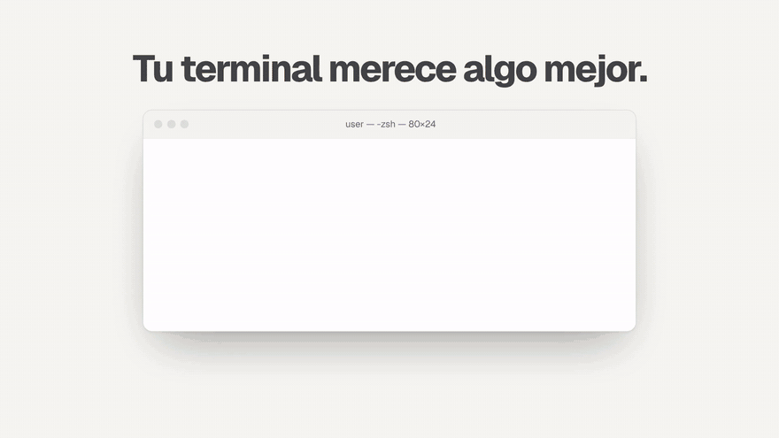
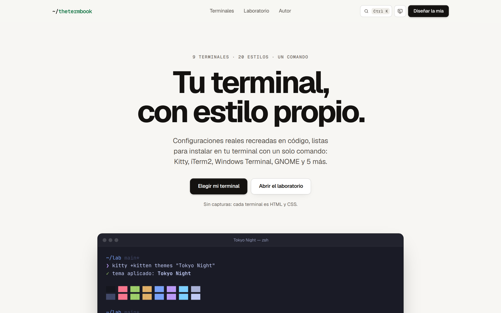
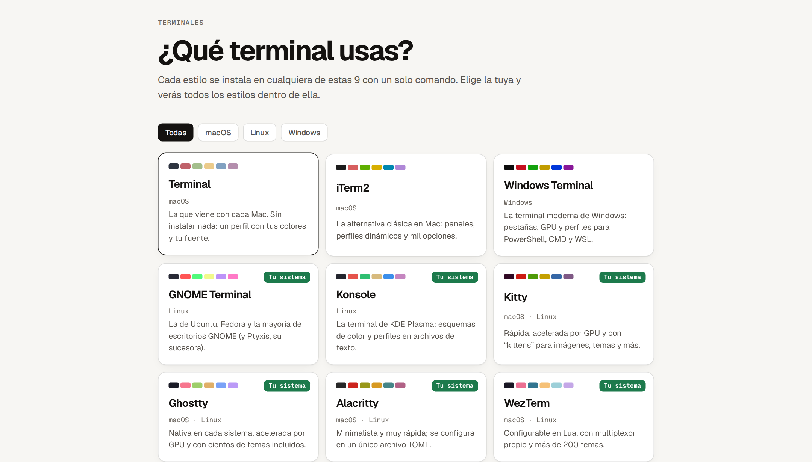
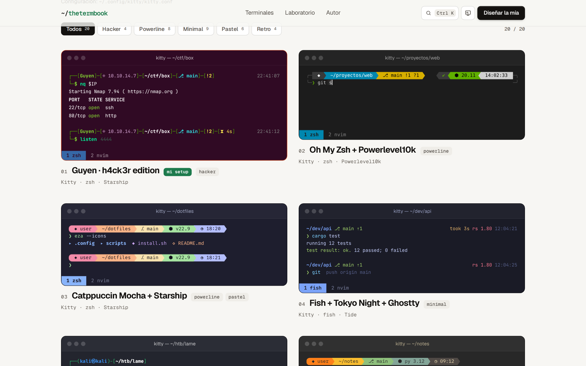
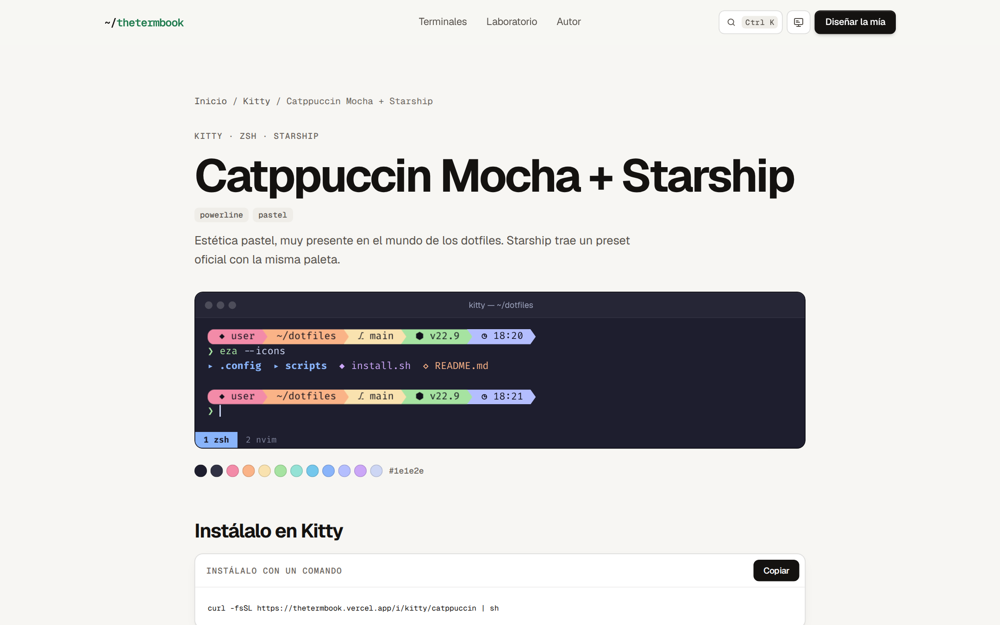
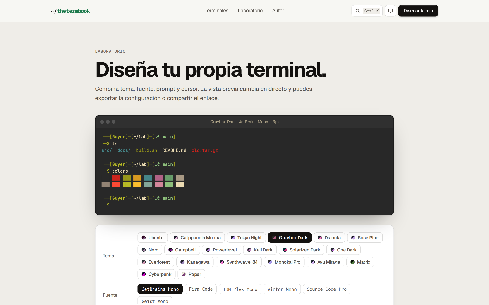

# ~/thetermbook

**Estilos de terminal que se instalan con una línea.**

[**thetermbook.vercel.app**](https://thetermbook.vercel.app)

---

thetermbook es un catálogo de estilos para la terminal: tema de colores, fuente y prompt, todo junto. Eliges la terminal que usas, eliges un estilo y lo instalas con un comando.

Funciona en **9 terminales**: Terminal de macOS, iTerm2, Windows Terminal, GNOME Terminal, Konsole, Kitty, Ghostty, Alacritty y WezTerm. Y tiene **20 estilos**, de Catppuccin y Dracula a Matrix, Synthwave o uno claro tipo papel.

## Qué puedes hacer

- **Ver cada estilo en tu terminal.** Cada ventana de la web está recreada en HTML y CSS con el marco real de su terminal, así que ves exactamente cómo te va a quedar.
- **Instalarlo con una línea.** `curl … | sh` en Mac y Linux, `irm … | iex` en Windows. Antes de tocar nada hace copia de seguridad y deja un desinstalador para volver atrás.
- **Verlas moverse.** Las terminales escriben solas y lanzan programas como btop, cmatrix o pipes.
- **Escribir en ellas.** Haz clic en una y prueba `help`, `neofetch`, `theme nord` o `btop`.
- **Diseñar la tuya.** En el laboratorio combinas tema, fuente, prompt y cursor, exportas la configuración y la compartes con un enlace corto.

## Capturas

<table>
  <tr>
    <td></td>
    <td></td>
  </tr>
  <tr>
    <td align="center">La portada</td>
    <td align="center">Eliges tu terminal</td>
  </tr>
  <tr>
    <td></td>
    <td></td>
  </tr>
  <tr>
    <td align="center">Todos los estilos dentro de ella</td>
    <td align="center">Y cada uno con su comando</td>
  </tr>
  <tr>
    <td colspan="2"></td>
  </tr>
  <tr>
    <td colspan="2" align="center">El laboratorio</td>
  </tr>
</table>

## Vídeo

- [Vídeo horizontal (32 s)](media/thetermbook.mp4)
- [Vídeo vertical para móvil (32 s)](media/thetermbook-vertical.mp4)

## En números

| | |
|---|---|
| Terminales | 9 |
| Estilos | 20 |
| Instaladores distintos | 180, probados de verdad en Ubuntu, macOS y Windows |
| Hecho con | Astro, TypeScript, Turso y Vercel |

El código del proyecto es privado.

## Autor

**Izan**: me gusta cacharrear con terminales y dejarlas bonitas.

[GitHub](https://github.com/diogenes4134) · [Instagram](https://www.instagram.com/izandiazph/)
